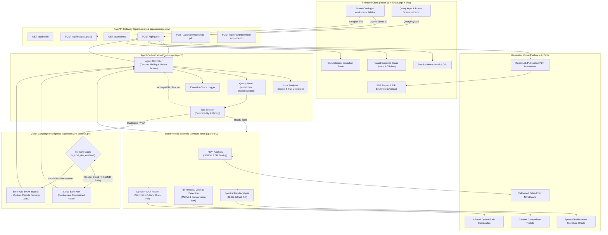

# SatQuery AI

**An Interactive Vision-Language Assistant for Multimodal Remote Sensing Image Analysis through Natural Language Text Queries**

[](https://sat-query-ai-snowy.vercel.app/)
[](https://satquery-ai-cloi.onrender.com/api/health)
[](https://github.com/SAYAN-8927/SatQuery-AI)
[](https://www.python.org/)
[](https://fastapi.tiangolo.com/)
[](https://react.dev/)
[](https://vitejs.dev/)

---

## Smart India Hackathon Context

| Field | Detail |
| :--- | :--- |
| **Event** | Smart India Hackathon (SIH) 2026 |
| **Problem Statement ID** | **SIH26167** |
| **Problem Title** | Interactive Vision-Language Assistant for Multimodal Remote Sensing Image Analysis through Text Queries |
| **Team Name** | **NullPointers01** |
| **Repository** | [github.com/SAYAN-8927/SatQuery-AI](https://github.com/SAYAN-8927/SatQuery-AI) |

---

## Quick Demo & Public Links

- **Live Web Application:** [https://sat-query-ai-snowy.vercel.app/](https://sat-query-ai-snowy.vercel.app/)
- **Backend API Health Check:** [https://satquery-ai-cloi.onrender.com/api/health](https://satquery-ai-cloi.onrender.com/api/health)
- **Source Code:** [https://github.com/SAYAN-8927/SatQuery-AI](https://github.com/SAYAN-8927/SatQuery-AI)

> **Render Free-Tier Notice:** The public backend is hosted on Render's free tier, which enters a low-power sleep state after periods of inactivity. If the service is sleeping, the first request will experience a cold-start delay of approximately 50–90 seconds while the backend spins up. The frontend includes an automatic recovery polling loop (checking `/api/health` every 6 seconds with a 3-minute recovery window) and transitions from a `Backend Waking` badge to `Backend Connected` once ready.

---

## Table of Contents

1. [Project Overview](#1-project-overview)
2. [Feature Summary & Capabilities](#2-feature-summary--capabilities)
3. [System Architecture](#3-system-architecture)
4. [Technology Stack](#4-technology-stack)
5. [Repository Structure](#5-repository-structure)
6. [Local Installation and Setup](#6-local-installation-and-setup)
7. [Usage Guide & Verified Query Examples](#7-usage-guide--verified-query-examples)
8. [Public Demo & Deployment Architecture](#8-public-demo--deployment-architecture)
9. [Scientific Methodology & Limitations](#9-scientific-methodology--limitations)
10. [Dataset Sources & Acknowledgements](#10-dataset-sources--acknowledgements)
11. [Testing & Troubleshooting](#11-testing--troubleshooting)
12. [Roadmap & Contribution](#12-roadmap--contribution)

---

## 1. Project Overview

### The Problem
Earth Observation (EO) satellite programs (such as USGS/NASA Landsat, ISRO resources, and Copernicus Sentinel constellations) generate massive volumes of high-value planetary imagery daily. However, extracting actionable insights typically requires domain specialists to:
1. Search and download multi-band raster data (e.g., $B_2, B_3, B_4, B_5$, $\text{VV}, \text{VH}$).
2. Operate desktop GIS software (QGIS, ArcGIS, ENVI) or write low-level Python scripts using GDAL and Rasterio.
3. Manually identify sensor calibration constants, coordinate reference systems (CRS), and complex mathematical formulas.
4. Manually choose and configure the appropriate remote-sensing algorithms for each task.

For field officers, disaster response coordinators, agricultural planners, and environmental monitors, this workflow creates a severe operational bottleneck.

### The Solution: SatQuery AI
**SatQuery AI** transforms this workflow into an interactive conversational process. Users ask natural-language questions such as:
- *"Calculate NDVI and explain the vegetation health."*
- *"Compare these two dates and tell me what changed."*
- *"Analyze this scene using optical and SAR data."*

Instead of passing raw satellite rasters directly into a generic text model that might hallucinate metrics, SatQuery AI employs a **tripartite hybrid architecture**:
1. **Agentic Orchestration Engine:** Parses user queries into distinct intents, binds strictly to the user's active scene or scene pair, and partitions operations into ready versus blocked tools based on physical band availability.
2. **Deterministic Scientific Compute Engine:** Processes 16-bit GeoTIFF tensors using exact physical formulas (USGS surface reflectance scaling, McFeeters NDWI, bi-temporal differencing, Sentinel-1 SAR Sigma-0 polarimetry) with zero mathematical hallucination.
3. **Domain-Adapted Remote Sensing VLM:** Utilizes a fine-tuned `SmolVLM-500M-Instruct` model with PEFT/LoRA adapters to provide qualitative narrative interpretation grounded directly in the deterministic figures computed by the scientific tools.
4. **Observable Auditability:** Generates pixel-level visual evidence (false-color maps, 3-panel comparison triplets, 4-panel fusion composites, spectral reflectance charts), full execution trace logs, and downloadable publication-grade PDF research reports.

---

## 2. Feature Summary & Capabilities

### Implementation Status Matrix

| Capability | Status | Description | Verified Source Code |
| :--- | :---: | :--- | :--- |
| **GeoTIFF / TIFF Upload & Validation** | **Completed** | Multipart upload with 1 MB streaming chunks (zero RAM spike), format validation, CRS extraction, resolution and band count detection. | `app/api/images.py`, `app/services/image_validation.py` |
| **Multispectral Band Handling** | **Completed** | Automated detection of Landsat-8/9 bands (B2 Blue, B3 Green, B4 Red, B5 NIR), Collection 2 surface reflectance scaling ($DN \times 0.0000275 - 0.2$), RGB composite generation. | `app/services/band_identifier.py`, `app/services/multispectral_processor.py` |
| **Natural-Language Query Parsing** | **Completed** | Multi-intent decomposition, keyword extraction, clause position sorting, and modality/band requirement identification. | `app/agent/query_parser.py` |
| **Agentic Tool Selection & Gating** | **Completed** | Validates scene compatibility, prevents context replacement bugs, partitions operations into `ready_tools` and `blocked_tools`. | `app/agent/tool_selector.py`, `app/agent/controller.py` |
| **Deterministic NDVI Analysis** | **Completed** | Calibrated Normalized Difference Vegetation Index calculation, denominator zero-guard, $[-1.0, +1.0]$ clipping, and 5-class colored spatial map generation. | `app/tools/ndvi_analysis.py`, `app/services/multispectral_processor.py` |
| **NDWI Water-Index Analysis** | **Completed** | McFeeters (1996) open water body delineation using Green (B3) and NIR (B5) bands, returning surface water percentage. | `app/tools/spectral_analysis.py` |
| **4-Band Spectral Profile Analysis** | **Completed** | Per-band statistics across B2, B3, B4, B5, Simple Ratio ($B_5/B_4$), and Pillow-generated dark-themed spectral reflectance profile chart. | `app/tools/spectral_analysis.py` |
| **Bi-Temporal Change Detection** | **Completed** | Dual-date coregistered NDVI differencing ($\Delta\text{NDVI}$), shared valid mask intersection, Gain / Loss / Stable pixel conservation, and 3-panel comparison triplet. | `app/tools/change_detection.py` |
| **Multimodal Optical + SAR Fusion** | **Completed** | Cross-sensor fusion combining Landsat optical imagery with Sentinel-1 dual-polarization SAR (VV/VH). Generates Sigma-0 backscatter (dB), RVI, radar water mask, and 4-panel composite. | `app/tools/optical_sar_fusion.py` |
| **Visual Evidence Generation** | **Completed** | Automated generation of PNG visual artifacts: NDVI heatmaps, change triplets, spectral charts, and optical-SAR composites. | `app/tools/` |
| **Downloadable Research PDF Reports** | **Completed** | 1,200+ line ReportLab report engine generating publication-grade PDFs with running headers/footers, metadata tables, equations, statistics, embedded figures, and execution traces. | `app/services/report_generator.py`, `app/api/images.py` |
| **Visual Evidence ZIP Packaging** | **Completed** | Endpoints bundling all generated visual evidence rasters into a single downloadable ZIP archive. | `app/api/images.py` |
| **Remote Sensing VLM (SmolVLM + LoRA)** | **Completed** | Base `SmolVLM-500M-Instruct` adapted via PEFT LoRA for satellite VQA. Configured with lazy loading, memory safety guards, and dynamic token budgeting. | `app/tools/vlm_analysis.py`, `app/ai/lora_adapter_rs/` |
| **Deployment-Aware VLM Memory Guard** | **Completed** | Automatically detects low-memory cloud hosts (Render 512 MB limit) and bypasses heavy deep learning inference while preserving all scientific raster tools. | `app/tools/vlm_analysis.py`, `app/main.py` |
| **Rigorous Radar Orthorectification (RTC)** | **Prototype** | Uses `rasterio.warp.reproject` with affine transformation and GCPs. Does not perform full Doppler-centroid range-Doppler terrain correction with DEMs. | `app/tools/optical_sar_fusion.py` |
| **Dynamic Biome-Calibrated Thresholds** | **Prototype** | Uses fixed prototype thresholds ($\pm 0.10\ \Delta\text{NDVI}$) rather than adaptive per-biome statistical thresholding. | `app/tools/change_detection.py` |
| **Dense Multi-Temporal Time Series (>2 Dates)** | **Planned** | Currently processes bi-temporal pairs ($T_1 \to T_2$). Dense time-series stacks (e.g., 10-date phenology) are planned. | Future Roadmap |
| **Interactive GIS Slippy Maps** | **Planned** | Maps are currently rendered as static high-resolution PNG rasters rather than interactive vector/raster slippy tiles (Leaflet / MapLibre). | Future Roadmap |

---

## 3. System Architecture

### Request Flow
1. **User Interface (React 19 / Vite):** The user selects or uploads imagery, selects an active scene or scene pair in the catalog, and submits a query.
2. **FastAPI Backend (`app/main.py` & `app/api/images.py`):** Ingests the query payload with explicit `active_scene_id`, `mode`, and session workspace headers.
3. **Input Analyzer (`app/agent/input_analyzer.py`):** Catalogs available GeoTIFF bands, bi-temporal pairs, and optical-SAR pairings.
4. **Query Parser (`app/agent/query_parser.py`):** Decomposes queries into primary and secondary intents, identifies required bands, and extracts temporal parameters.
5. **Tool Selector (`app/agent/tool_selector.py`):** Evaluates physical input compatibility against the active scene context and partitions requests into ready versus blocked tools.
6. **Tool Execution Engine (`app/agent/tool_executor.py`):** Dispatches calls to deterministic scientific tools (`ndvi_analysis`, `spectral_analysis`, `change_detection`, `optical_sar_fusion`) and/or `vlm_analysis`.
7. **Result Interpreter (`app/agent/result_interpreter.py`):** Translates raw output matrices into qualitative narrative summaries and calculates calibrated confidence scores.
8. **Visual Evidence & Reporting (`app/services/report_generator.py`):** Synthesizes outputs into visual evidence artifacts, chronological execution traces, and downloadable PDF reports.

### Architecture Diagram



---

## 4. Technology Stack

### Frontend
- **Framework:** React 19.2.8
- **Build Tool:** Vite 8.3.0
- **Language:** TypeScript 6.0.2
- **Styling:** Custom Vanilla CSS design tokens (`frontend/src/index.css`, ~87 KB) featuring dark mode, orbital visual animations, and glassmorphism. Avoids TailwindCSS overhead.
- **Icons:** Lucide React 1.47.0
- **Micro-Interactions:** Canvas Confetti 1.9.4
- **Linter:** Oxlint 1.81.0

### Backend
- **Framework:** FastAPI 0.141.1
- **ASGI Server:** Uvicorn 0.52.4
- **Data Validation:** Pydantic 2.13.5
- **File Ingestion:** Python-Multipart 0.0.32
- **HTTP Client:** Requests 2.34.2

### Geospatial & Numerical Processing
- **Raster Processing:** Rasterio 1.5.1 (GDAL bindings)
- **Scientific Computing:** NumPy 2.5.3
- **Image Manipulation & Chart Generation:** Pillow (PIL) 12.3.0

### Machine Learning & Vision-Language Modeling
- **Base Architecture:** `HuggingFaceTB/SmolVLM-500M-Instruct`
- **Parameter-Efficient Fine-Tuning (PEFT):** PEFT 0.21.0 (LoRA adapter weights: 6.58 MB safetensors)
- **Deep Learning Framework:** PyTorch (with CUDA support locally)
- **Transformers Library:** Hugging Face Transformers 5.17.0
- **Model Storage:** Safetensors 0.8.0, Hugging Face Hub 1.32.0, Accelerate 1.15.0

### Reporting & Documentation
- **PDF Generation Engine:** ReportLab 5.0.1 (Custom 2-pass numbered canvas with tables and figures)

### Hosting & Infrastructure
- **Frontend Hosting:** Vercel (Edge network deployment with API rewrites via `vercel.json`)
- **Backend Hosting:** Render (Free-tier web service deployment with auto-sleep)
- **Local Compute Target:** Windows 11 workstation with NVIDIA GeForce GTX 1650 (4 GB GDDR6)

---

## 5. Repository Structure

```
SatQuery-AI/
├── app/
│   ├── agent/
│   │   ├── controller.py              # Main orchestrator; active scene binding & result fusion
│   │   ├── execution_trace.py         # Timestamped audit step logger
│   │   ├── input_analyzer.py          # Ingests rasters, detects Landsat scenes & SAR polarizations
│   │   ├── query_parser.py            # Multi-intent decomposition & keyword extraction
│   │   ├── result_interpreter.py      # Translates tensors to narratives; heuristic confidence scoring
│   │   ├── tool_executor.py           # Uniform dispatch to scientific analysis tools
│   │   ├── tool_registry.py           # Registry of operational tools
│   │   └── tool_selector.py           # Physical band validator & ready/blocked partitioner
│   ├── ai/
│   │   ├── dataset/                   # Benchmark metadata & evaluation metrics
│   │   ├── lora_adapter_rs/           # Domain-adapted LoRA adapter weights (adapter_model.safetensors)
│   │   ├── build_rs_vqa_dataset.py    # Builds QA pairs from EuroSAT Sentinel-2 patches
│   │   ├── evaluate_vlm.py            # Validation script for VLM recognition
│   │   └── train_vlm_lora.py          # LoRA fine-tuning training pipeline
│   ├── api/
│   │   └── images.py                  # API routes: uploads, catalog, query execution, PDF & ZIP exports
│   ├── services/
│   │   ├── band_identifier.py         # Identifies Landsat spectral bands from filenames/metadata
│   │   ├── image_classification.py    # Classifies image type (multispectral, single-band, RGB)
│   │   ├── image_validation.py        # Validates file extensions and GeoTIFF headers
│   │   ├── multispectral_processor.py # Reads bands, scales surface reflectance, generates RGB composites
│   │   ├── raster_preprocessor.py     # Generates lightweight preview thumbnails
│   │   ├── raster_processor.py        # Extracts raster metadata (CRS, bounds, dimensions)
│   │   ├── report_generator.py        # ReportLab PDF research report generator
│   │   ├── sar_identifier.py          # Identifies Sentinel-1 SAR SAFE and GRD polarizations
│   │   └── workspace_manager.py       # Manages per-session isolated upload directories
│   ├── tools/
│   │   ├── change_detection.py        # Bi-temporal NDVI differencing & 3-panel comparison triplet
│   │   ├── ndvi_analysis.py           # Deterministic NDVI calculation & spatial map generation
│   │   ├── optical_sar_fusion.py      # Sentinel-1 SAR Sigma-0 polarimetry & 4-panel composite
│   │   ├── scene_metadata.py          # Scene geospatial metadata inspection
│   │   ├── spectral_analysis.py       # 4-band reflectance stats, NDWI, & spectral signature charts
│   │   ├── unsupported_capability.py  # Graceful messaging for out-of-scope requests
│   │   └── vlm_analysis.py            # SmolVLM inference engine & deployment memory guard
│   └── main.py                        # FastAPI entry point, CORS, static mounts, and health check
├── frontend/
│   ├── src/
│   │   ├── components/
│   │   │   ├── ConfidenceCard.tsx     # Visual confidence indicator and contributing factors
│   │   │   ├── EvidenceViewer.tsx     # High-resolution raster map and composite viewer
│   │   │   ├── ExecutionTrace.tsx     # Chronological execution audit log
│   │   │   ├── Header.tsx             # Header bar with real-time backend connection status
│   │   │   ├── QuerySection.tsx       # Query input bar and preset scenario cards
│   │   │   ├── ResultView.tsx         # Results stage, metrics grid, narrative, and download buttons
│   │   │   └── SceneSidebar.tsx       # Scene catalog, active scene selection, and upload dropzone
│   │   ├── pages/
│   │   │   ├── DashboardPage.tsx      # Main operational dashboard & cold-start retry loop
│   │   │   ├── LandingPage.tsx        # Hero section with animated orbital visualizer
│   │   │   └── BandPreviewPage.tsx    # Single-band inspection page
│   │   ├── api.ts                     # Frontend HTTP API client & health check handling
│   │   ├── App.tsx                    # Root React component
│   │   ├── index.css                  # Custom design system and CSS tokens
│   │   └── types.ts                   # TypeScript interfaces for API payloads and results
│   ├── package.json                   # Frontend dependencies and build scripts
│   ├── tsconfig.json                  # TypeScript compiler configuration
│   ├── vercel.json                    # Vercel deployment routing and backend API rewrites
│   └── vite.config.ts                 # Vite bundler configuration
├── uploads/                           # Default upload and preview storage directory
├── requirements.txt                   # Minimal backend dependencies
├── requirements-render.txt            # Complete pinned dependencies for deployment
├── run_30_tests.py                    # 30-test end-to-end regression test suite
├── test_memory_optimization.py        # Memory footprint and VLM bypass verification test
├── test_scientific_active_scene_audit.py # Authoritative active scene binding audit test
├── test_multimodal_pairing.py         # Bi-temporal and optical-SAR pairing test
├── test_cold_start_recovery.py        # Cold-start retry and wake-up validation test
└── README.md                          # Project documentation
```

---

## 6. Local Installation and Setup

### Prerequisites
- **Operating System:** Windows 10/11 (or Linux / macOS)
- **Python:** Python 3.11 to 3.13 (64-bit recommended)
- **Node.js:** Node.js v18+ and npm
- **GPU (Optional):** NVIDIA GPU with CUDA support for running local VLM inference (e.g., GTX 1650 4 GB or higher). If no GPU is available or running under cloud memory limits, the system runs with local VLM bypassed while all scientific raster tools remain operational.

### 1. Clone the Repository
Open Windows PowerShell and clone the project:
```powershell
git clone https://github.com/SAYAN-8927/SatQuery-AI.git
Set-Location -Path ".\SatQuery-AI"
```

### 2. Set Up the Python Virtual Environment
Create and activate a virtual environment:
```powershell
python -m venv venv
.\venv\Scripts\Activate.ps1
```

### 3. Install Backend Dependencies
To install the complete pinned dependencies (including Rasterio, PyTorch, Transformers, PEFT, and ReportLab):
```powershell
python -m pip install --upgrade pip
pip install -r requirements-render.txt
```
*(For a minimal setup without deep learning dependencies, install via `pip install -r requirements.txt`).*

### 4. Configure Environment Variables (Optional)
By default, the backend enables local VLM inference if a local environment is detected. To explicitly configure behavior:
```powershell
# To explicitly enable local VLM (requires adequate GPU/CPU RAM):
$env:ENABLE_LOCAL_VLM="true"

# Or to simulate a low-memory cloud host (VLM bypassed, scientific tools active):
$env:ENABLE_LOCAL_VLM="false"
```

### 5. Start the FastAPI Backend
Launch the backend using Uvicorn:
```powershell
uvicorn app.main:app --reload --host 127.0.0.1 --port 8000
```
Verify that the backend is running by navigating to [http://127.0.0.1:8000/api/health](http://127.0.0.1:8000/api/health). You should see:
```json
{
  "status": "ok",
  "service": "SatQuery AI Backend",
  "vlm_enabled": true,
  "runtime_environment": "local_gpu",
  "device": "NVIDIA GTX 1650 (FP16)"
}
```

### 6. Install Frontend Dependencies and Start Dev Server
Open a second PowerShell terminal in the project root:
```powershell
Set-Location -Path ".\frontend"
npm install
npm run dev
```
Open your browser to the local Vite development URL (typically [http://localhost:5173/dashboard](http://localhost:5173/dashboard)).

---

## 7. Usage Guide & Verified Query Examples

### Workflow in the Dashboard
1. **Explore or Upload Imagery:**
   - In the left **Scene Library Sidebar**, view existing demonstration scenes or drop new GeoTIFF files (`.tif`, `.tiff`) into the upload zone.
   - For multispectral processing, upload Landsat-8/9 Collection 2 bands ($B_2, B_3, B_4, B_5$) or Sentinel-1 SAR files ($\text{VV}, \text{VH}$).
2. **Select Active Scene Context:**
   - Click a scene to set it as the **Active Scene** (highlighted with an authoritative badge).
   - Alternatively, toggle to **Bi-Temporal Pair** or **Optical + SAR Pair** when running comparative analysis.
3. **Submit a Query:**
   - Either select one of the 1-click **Scenario Preset Cards** (which populates the query input) or type a custom natural-language query into the search bar.
   - Click the **[Analyse]** button or press **Enter**.
4. **Inspect Results:**
   - **Metrics Grid:** View calculated values (Mean NDVI, NDWI, Gain/Loss percentages, or SAR backscatter dB).
   - **Visual Evidence:** Inspect generated spatial maps, 3-panel comparison triplets, or 4-panel fusion composites in the evidence stage.
   - **Qualitative Interpretation:** Read the narrative synthesis explaining the physical findings.
   - **Execution Trace:** Expand the chronological audit log to view each agent step, duration, and decision.
5. **Download Reports:**
   - Click **[Download PDF Report]** to generate a publication-grade ReportLab PDF.
   - Click **[Download Evidence ZIP]** to download all generated visual rasters.

### Verified Query Archetypes

| Scenario | Verified Example Query | Required Input Condition | Selected Tool | Output Evidence |
| :--- | :--- | :--- | :--- | :--- |
| **Vegetation Analysis** | *"Calculate NDVI and explain the vegetation."* | Active Landsat scene with $B_4$ (Red) and $B_5$ (NIR). | `ndvi_analysis` | Mean NDVI (+0.184) and false-color spatial NDVI heatmap. |
| **Spectral Characteristics** | *"Analyze the spectral characteristics of this image."* | Active Landsat scene with $B_2, B_3, B_4, B_5$. | `spectral_band_analysis` | 4-band reflectance stats, McFeeters NDWI, and dark-themed spectral profile chart. |
| **Bi-Temporal Change** | *"Compare these two dates and tell me what changed."* | Active Bi-Temporal Pair ($T_1 \to T_2$). | `change_detection_model` | $\Delta\text{NDVI}$, Gain %, Loss %, Stable %, and 3-panel comparison triplet. |
| **Optical + SAR Fusion** | *"Analyze this scene using optical and SAR data."* | Optical Landsat scene + Sentinel-1 SAR scene (VV, VH). | `optical_sar_model` | SAR $\sigma^0$ (dB), RVI, radar water mask, and 4-panel fusion composite. |
| **Visual VQA** | *"Describe what is visible in this image."* | Active optical image or RGB preview. | `remote_sensing_vlm` | Terrain and feature description (executed on local GPU; bypassed on cloud). |
| **Scene Metadata** | *"What are the metadata parameters of this image?"* | Any uploaded GeoTIFF raster. | `scene_metadata` | CRS, affine transform, raster dimensions, data types, and nodata values. |

### Autonomous Gating & Safety Protection
SatQuery AI enforces strict contextual integrity:
- **Change detection requested on a single scene:** The agent blocks execution with an informative message:
  > *"Change detection requires a compatible before/after scene pair. The current analysis context contains only one scene. Please select a bi-temporal pair."*
- **Optical + SAR requested without SAR data:** The agent blocks execution rather than auto-switching or hallucinating radar channels:
  > *"Optical + SAR analysis requires a compatible SAR scene. The currently selected scene is optical-only. Please select or upload a compatible Sentinel-1 SAR scene."*
- **Scientific calculation requested on standard RGB photo:** The agent explains that standard photographic RGB lacks calibrated NIR/Red physical bands, while still permitting visual VQA questions.

---

## 8. Public Demo & Deployment Architecture

### Deployment Configuration
- **Frontend:** Hosted on **Vercel** ([https://sat-query-ai-snowy.vercel.app/](https://sat-query-ai-snowy.vercel.app/)).
  - Configured with `vercel.json` rewrites to proxy all `/api/*` and `/uploads/*` requests to the Render backend, preventing browser Cross-Origin (CORS) complications.
- **Backend:** Hosted on **Render** as a Python Web Service ([https://satquery-ai-cloi.onrender.com/api/health](https://satquery-ai-cloi.onrender.com/api/health)).
  - Runs with 512 MB RAM on the Render free tier.

### Render Free-Tier Cold Starts & Recovery
Because Render automatically spins down free-tier instances after 15 minutes of inactivity:
1. **Cold-Start Delay:** When a visitor opens the Vercel site after a period of dormancy, the first request triggers a container wake-up that takes 50–90 seconds.
2. **Frontend Auto-Recovery:** The frontend dashboard monitors backend health via `checkHealth()`:
   - Polling occurs every **6 seconds**.
   - A **3-minute recovery window** prevents premature timeouts.
   - The UI status badge transitions to `Backend Waking`.
   - Once the backend responds with HTTP 200, the status transitions to `Backend Connected` and scenes load automatically without requiring a manual page refresh.

---

## 9. Scientific Methodology & Limitations

### Mathematical Formulations

#### 1. Normalized Difference Vegetation Index (NDVI)
$$\text{NDVI} = \frac{\rho_{\text{NIR}} - \rho_{\text{Red}}}{\rho_{\text{NIR}} + \rho_{\text{Red}}}$$
- **Bands:** Landsat-8/9 Band 4 (Red, $0.64–0.67\ \mu\text{m}$) and Band 5 (NIR, $0.85–0.88\ \mu\text{m}$).
- **USGS Collection 2 Surface Reflectance Scaling:**
  $$\rho = (\text{DN} \times 0.0000275) - 0.2$$
- **Safeguards:** Valid only where $|\rho_{\text{NIR}} + \rho_{\text{Red}}| > 10^{-6}$; clipped to theoretical bounds $[-1.0, +1.0]$.

#### 2. Normalized Difference Water Index (NDWI — McFeeters 1996)
$$\text{NDWI} = \frac{\rho_{\text{Green}} - \rho_{\text{NIR}}}{\rho_{\text{Green}} + \rho_{\text{NIR}}} = \frac{B_3 - B_5}{B_3 + B_5}$$
- **Delineation:** Positive values ($\text{NDWI} > 0.0$) delineate surface open water; negative values indicate terrestrial land, canopy, or bare soil.

#### 3. Bi-Temporal NDVI Differencing
$$\Delta\text{NDVI} = \text{NDVI}_{T2} - \text{NDVI}_{T1}$$
- **Conservation of Area:** Calculated over the intersection of valid pixels across all 4 input bands.
- **Categorization:**
  - Vegetation Gain: $\Delta\text{NDVI} > +0.10$
  - Vegetation Loss: $\Delta\text{NDVI} < -0.10$
  - Stable Terrain: $-0.10 \le \Delta\text{NDVI} \le +0.10$
  $$\text{Gain}\% + \text{Loss}\% + \text{Stable}\% = 100.00\%$$

#### 4. Synthetic Aperture Radar (SAR) Polarimetry
- **Linear Sigma-0 Backscatter from ESA Level-1 GRD:**
  $$\sigma^0_{\text{linear}} = \frac{\text{DN}^2}{A_\sigma^2} \quad (\text{nominal calibration constant } A_\sigma = 350.0)$$
- **Decibel (dB) Conversion:**
  $$\sigma^0_{\text{dB}} = 10 \cdot \log_{10}(\sigma^0_{\text{linear}} + 10^{-7})$$
- **Radar Vegetation Index (RVI):**
  $$\text{RVI} = \frac{4 \cdot \sigma^0_{\text{VH,lin}}}{\sigma^0_{\text{VV,lin}} + \sigma^0_{\text{VH,lin}}}$$
- **Radar Water Delineation:** $\sigma^0_{\text{VV}} < -18.0\text{ dB}$ (specular reflectance of microwave pulses away from the receiver).

### Deterministic vs. VLM Interpretation
SatQuery AI maintains an explicit distinction between computation and narrative:
- **All numerical metrics** (means, fractions, standard deviations, delta percentages, backscatter decibels) and spatial evidence maps are computed **deterministically** using Rasterio and NumPy.
- **The Vision-Language Model** is never asked to calculate or estimate metrics. It receives the verified calculated values and provides qualitative contextual synthesis.

### Documented Limitations
1. **Cloud VLM Bypass on Render Free Tier:** The public Render host enforces a 512 MB RAM ceiling. Because `SmolVLM-500M` requires ~1.66 GB RAM, deep learning inference is automatically bypassed on the live cloud demo (`deployment_constrained=True`). All deterministic raster tools remain fully operational.
2. **Local GPU Requirement for VLM:** Local VLM inference requires a capable GPU (tested on NVIDIA GTX 1650 4 GB with FP16 base weights and strict 384x384 image patch downsampling).
3. **Radar Orthorectification (RTC) Approximation:** Sentinel-1 SAR rasters are co-registered to the optical UTM grid using Ground Control Points (GCPs) and Rasterio affine warp with bilinear resampling. The system does not execute full Doppler-centroid range-Doppler terrain correction with DEMs.
4. **Heuristic Confidence Estimation:** Confidence scores are calculated heuristically based on band completeness, sensor alignment, and radiometric validity factors rather than Bayesian probabilities.
5. **Pending Benchmark Evaluations:** Ground-truth validation of the fine-tuned VLM on held-out EuroSAT Sentinel-2 test samples achieved **33.33% overall recognition accuracy** (22.22% exact multi-class terrain match, 50.00% binary verification). Formal evaluations on external benchmarks (**VRSBench**, **RSVQA**, **CDVQA**, and **ISRO/SAC** datasets) have not yet been conducted and remain pending.

---

## 10. Dataset Sources & Acknowledgements

### Data Sources Utilized in the Repository
- **ISRO / NRSC BHOONIDHI:** Demonstration Landsat-9 OLI-2 imagery (`LC91340522026109SGI00`, acquired 19-Apr-2026) and Sentinel-1A C-SAR IW GRDH dual-polarization imagery (acquired 13-Apr-2026) over Port Blair, Andaman & Nicobar Islands, were acquired through the **BHOONIDHI open data portal** (ISRO/NRSC).
- **USGS / NASA EarthExplorer:** Operational Landsat-8 and Landsat-9 Collection 2 Level-2 Surface Reflectance rasters (`LC08_L2SP_139041` and `LC09_L2SP_141040`).
- **European Space Agency (ESA) Copernicus Programme:** Sentinel-1 C-SAR IW GRDH radar measurements and Sentinel-2 optical imagery via EuroSAT RGB (`blanchon/EuroSAT_RGB` on Hugging Face; 150 patches used to derive 645 QA pairs for VLM LoRA domain adaptation).

### External Benchmarks & Future Targets
The following datasets are recognized as domain benchmarks for remote sensing VQA, change detection, and classification:
- **VRSBench:** Visual reasoning and remote sensing question answering benchmark.
- **RSVQA:** Remote sensing visual question answering benchmark.
- **CDVQA:** Change detection visual question answering benchmark.
- **BigEarthNet:** Large-scale Sentinel-1 and Sentinel-2 multi-label benchmark.
- **ISRO/SAC Datasets:** Official Space Applications Centre satellite datasets for future operational evaluation.

*Note: These benchmarks are target datasets for our evaluation roadmap; they have not yet been evaluated in this repository.*

---

## 11. Testing & Troubleshooting

### Verified Test Suites
The repository includes several automated test scripts:

```powershell
# Run the 30-test end-to-end regression test suite (requires running backend on port 8000)
python run_30_tests.py

# Verify low-memory safety guards and deployment-aware VLM bypass
python test_memory_optimization.py

# Verify authoritative active scene binding across scientific queries
python test_scientific_active_scene_audit.py

# Verify bi-temporal and optical-SAR multimodal pairing logic
python test_multimodal_pairing.py

# Test cold-start recovery logic
python test_cold_start_recovery.py

# Verify frontend production build and linting
cd frontend
npm run build
npm run lint
```

### Common Troubleshooting Scenarios

1. **Backend Fails to Start (GDAL / Rasterio Issues on Windows):**
   - Ensure you are running 64-bit Python.
   - If Rasterio wheels fail to build, install pre-compiled binary wheels for Windows using `pip install -r requirements-render.txt`.
2. **Frontend Shows "Backend Disconnected":**
   - Verify that the FastAPI backend is running on `http://127.0.0.1:8000`.
   - In development mode, Vite proxies `/api` requests to port 8000. Check that the port matches in `frontend/vite.config.ts`.
3. **Render Free-Tier Delays:**
   - Wait 60–90 seconds for the free container to complete its cold start.
   - Monitor `https://satquery-ai-cloi.onrender.com/api/health` directly in your browser.
4. **Large GeoTIFF Upload Errors (HTTP 413 / Out of Memory):**
   - Full raw satellite scenes can exceed 800 MB to 1 GB.
   - On the 512 MB Render deployment, uploading uncropped multi-gigabyte files will exceed memory limits. Use pre-cropped regional GeoTIFFs (e.g., 50–100 MB) for public cloud uploads, or run the backend locally where disk and memory constraints are relaxed.

---

## 12. Roadmap & Contribution

### Future Roadmap
- [ ] **Formal Benchmark Evaluation:** Conduct evaluations on VRSBench, RSVQA, CDVQA, and official ISRO/SAC datasets.
- [ ] **Advanced Radar Processing:** Implement DEM-assisted Doppler-centroid range-Doppler Terrain Correction (RTC) using SNAP or GDAL.
- [ ] **Dynamic Biome Thresholds:** Replace fixed change detection thresholds with adaptive statistical differencing (e.g., Otsu's method or $\pm 2\sigma$ adaptive thresholds).
- [ ] **Interactive GIS Slippy Maps:** Transition from static PNG evidence rasters to interactive Leaflet/MapLibre slippy map tiles with pan, zoom, and layer toggle capabilities.
- [ ] **Multi-Temporal Dense Series:** Extend beyond bi-temporal pairs to support dense multi-date time series and seasonal phenology curves.

### Contributing
Contributions and suggestions are welcome:
1. Fork the repository.
2. Create a feature branch (`git checkout -b feature/improved-sar-calibration`).
3. Commit your changes (`git commit -m "Add DEM-assisted orthorectification"`).
4. Push to the branch (`git push origin feature/improved-sar-calibration`).
5. Open a Pull Request.

### License Status
**No open-source license has been specified yet for this repository.**  
All rights are currently reserved by **Team NullPointers01** for Smart India Hackathon (SIH 2026). An appropriate open-source license will be selected upon completion of evaluation.
